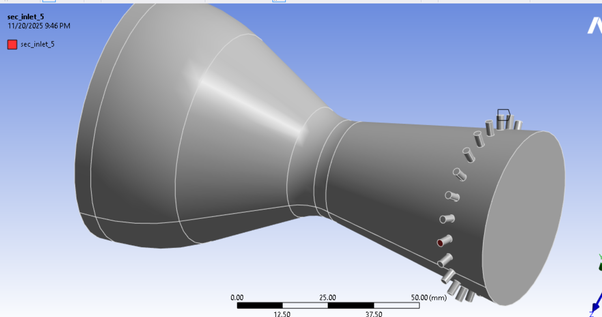
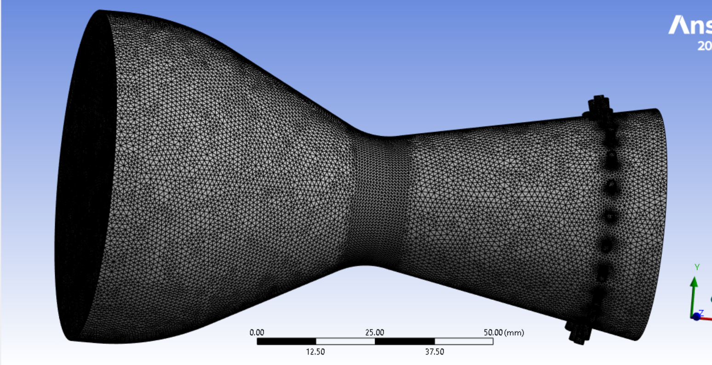
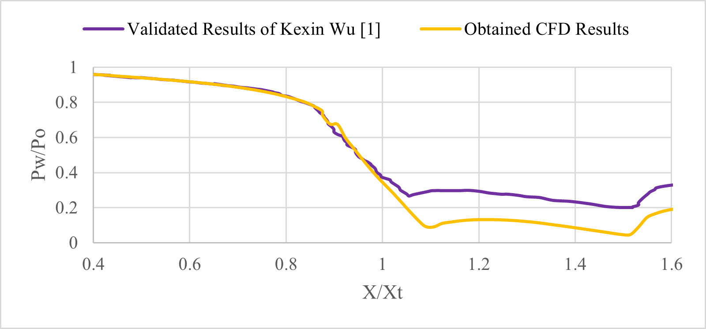

# fluidic-thrust-vectoring-cfd
Numerical analysis of Fluidic Thrust Vectoring (FTV) using secondary injection in a supersonic C-D nozzle using ANSYS Fluent and SolidWorks.
# Fluidic Thrust Vectoring (FTV) Analysis via Secondary Injection

## 📌 Executive Summary
This project investigates **Fluidic Thrust Vectoring (FTV)** through **Secondary Injection Thrust Vector Control (SITVC)** inside a supersonic convergent-divergent (C-D) nozzle. 

By eliminating traditional mechanical gimbals and heavy actuators, fluidic thrust vectoring injects a high-pressure secondary fluid stream into the divergent section of the primary nozzle. This creates a fluidic obstruction, inducing an oblique shock wave and asymmetric pressure distribution along the nozzle wall that deflects the main exhaust jet.

---

## 🛠️ Tools & Technical Stack
* **CAD Modeling:** SolidWorks 2025 (`with_(24)_sec_inlet(15deg).SLDPRT` exported via IGES format)
* **CFD Pre-Processing & Solver:** ANSYS Fluent (Density-Based Compressible Implicit Solver)
* **Turbulence Model:** k omega SST (Shear Stress Transport)
* **Working Fluid:** Ideal Gas Air (Sutherland's Viscosity Model)

---

## 📐 Computational Domain & Boundary Conditions

### 1. Geometry Configuration
* **Nozzle Profile:** Supersonic Convergent-Divergent (C-D) Nozzle
* **Secondary Injection Port:** Inclined at a 15 degree forward angle relative to the nozzle divergent wall to maximize flow detachment and momentum interaction.
* **Plume Integration:** Extended far-field domain downstream to eliminate artificial boundary reflection on the expanding jet.

### 2. Numerical Setup
| Parameter | Configuration |
| :--- | :--- |
| **Primary Inlet** | Pressure Inlet ($P_{0,p}$ Stagnation Pressure, T_0 = 300 K |
| **Secondary Inlet** | Pressure/Mass Flow Inlet 15 degree |
| **Wall Boundary** | No-Slip, Adiabatic Wall Treatment |
| **Far-Field Outlet** | Pressure Outlet P_{amb} = 101.325 kPa |
| **Discretization** | Second-Order Upwind Scheme for Momentum, Energy, and TKE |
| **Near-Wall Mesh** | Refined inflation layers y^+ approx to resolve boundary layer separation |

---

## 🔬 Physics & Flow Analysis
[ Primary Supersonic Stream ]
                              |
                              v
 ===========================\     /=========================== (Upper Wall)
                             \   /
                              \ /   Oblique Bow Shock Wave
                         ======V==============================
                               | \  <-- High Pressure Stagnation Zone
                  Secondary    |  \
                  Injection --> \  \=== (Deflected Exhaust Plume)
                  Port (15°)    \
### Key Physical Phenomena Observed:
1. **Oblique Bow Shock Formation:** The 15 degree secondary jet acts as a physical barrier to the supersonic primary flow, inducing an oblique shock wave upstream of the injection port.
2. **Upstream Separation Bubble:** Flow stagnation upstream of the port elevates local static pressure and creates a distinct recirculation region.
3. **Asymmetric Force Generation:** The stark pressure difference between the high-pressure region upstream of the port and the low-pressure wake region downstream produces a net lateral force F_y.
4. **Vector Angle ($\delta$):** The resulting pitch deflection angle of the plume is derived using surface force integrals:

$$\delta = \arctan\left(\frac{F_y}{F_x}\right)$$

Where:
* F_y = Net lateral force perpendicular to nozzle axis
* F_x = Net axial thrust force

---

## 🖼️ Simulation Results & Visuals

| 3D CAD Geometry | Computational Mesh |
| :---: | :---: |
|  |  |

| Mach Number Flowfield | Wall Static Pressure Distribution |
| :---: | :---: |
|  |  |

---

## 💡 Engineering Key Takeaways
* **Weight Reduction:** Solid-state fluidic vectoring removes mechanical actuators, significantly reducing system mass and response lag.
* **Control Effectiveness:** The 15 degree forward injection angle enhances shock strength and pressure delta, demonstrating effective vectoring performance for high-speed flight applications.

---

## 📬 Contact & Author
**Prajwal Sadashiv Jinde**  
*Aerospace & CFD Research Project*  
📧 Email: prajwal.aerocfd@gmail.com
